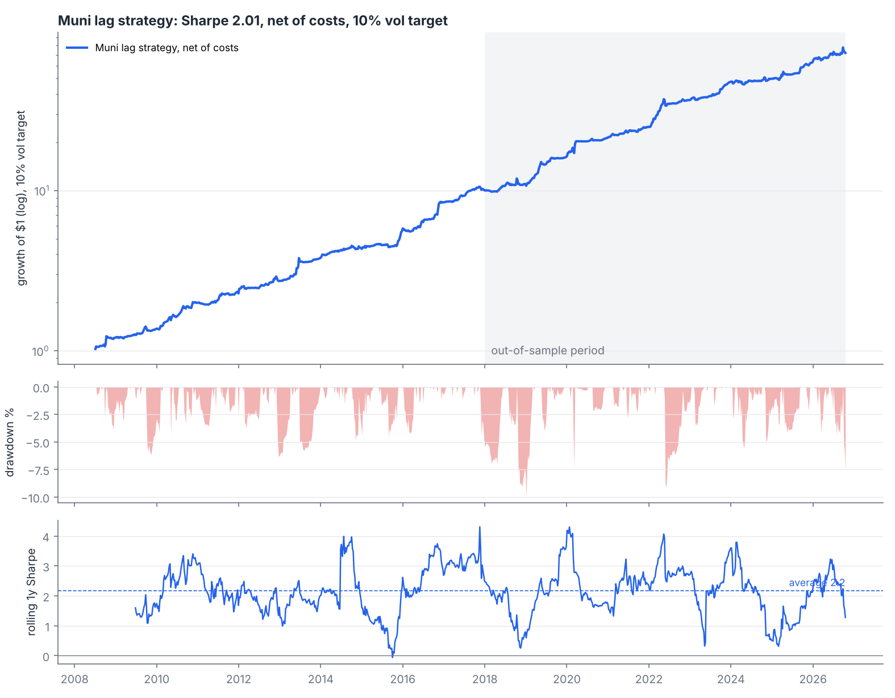
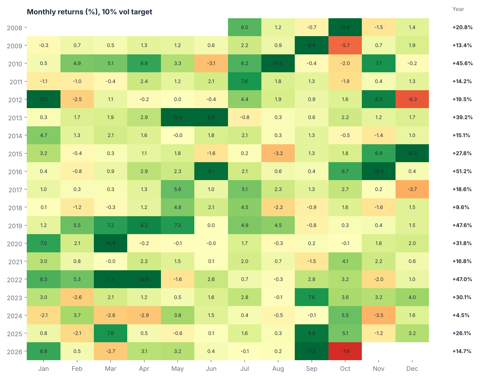
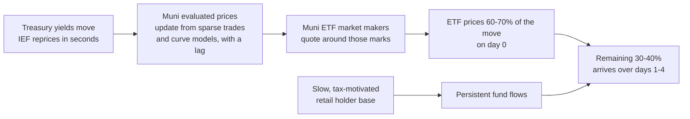
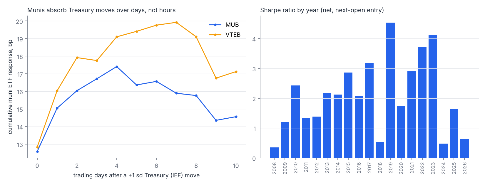
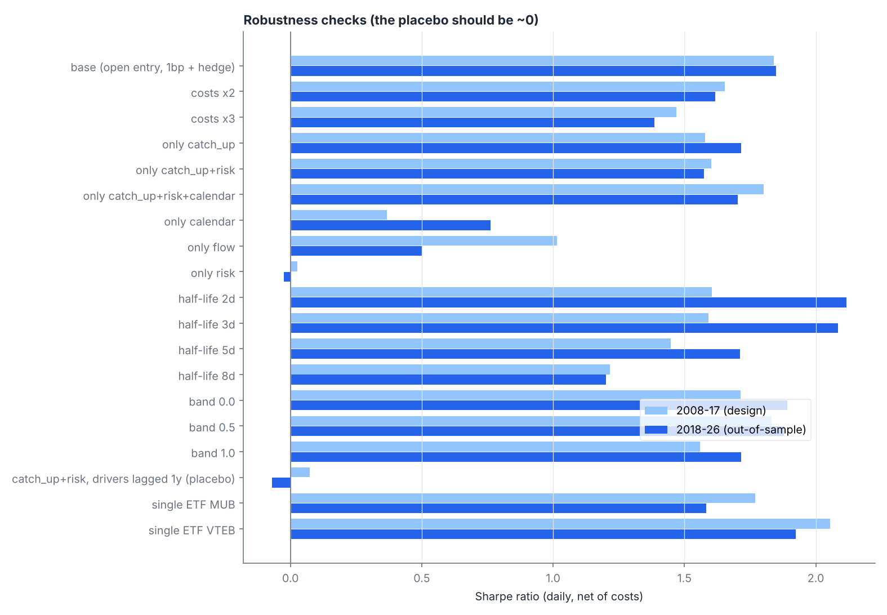

<div align="center">

# Muni Stale-Price Macro

Muni bond ETFs (MUB, VTEB) price 60-70% of a Treasury move on the day and the rest over the next 2-4 trading days.
This strategy trades that lag: long munis against a Treasury hedge after Treasuries rally, short after they fall.


**[Project website](https://vibgyor22.github.io/muni-stale-price-macro/)** | [Methodology](docs/methodology.md) | [Literature](docs/literature.md) | [Author](https://vibgyor22.github.io/personal-website/)

</div>

---

## Summary

- **The effect.** A distributed-lag regression of daily MUB returns on IEF returns gives a same-day beta of 0.30 (t = 17) and a further 0.15 over the next five days (joint test p = 0.001). For VTEB the lagged part is larger: 0.26 on top of 0.36 (p = 0.0003).
- **The trade.** Hold MUB and VTEB hedged with IEF at a rolling one-year beta, so the bet is the gap between munis and Treasuries and the direction of rates does not matter. Decide at the close, trade at the next open, pay costs.
- **The result.** Sharpe ratio 1.93 out of sample (2018-2026) and 2.01 over 2008-2026, net of costs at a 10% volatility target. Every calendar year is positive. Moving the Treasury input back one year (a placebo) gives a Sharpe ratio of zero.

## Results



| Weekly returns, 10% ex-ante vol target, net of costs | 2008-17 (design) | **2018-26 (out of sample)** | 2008-26 |
|:--|--:|--:|--:|
| Annual return (excess of cash) | 27.3% | **25.1%** | 26.2% |
| Volatility | 12.0% | **12.0%** | 12.0% |
| **Sharpe ratio** | 2.08 | **1.93** | 2.01 |
| Sortino ratio | 4.14 | **3.00** | 3.49 |
| Max drawdown | -6.3% | **-10.0%** | -10.0% |
| Calmar ratio | 4.33 | **2.50** | 2.61 |
| t-stat of Sharpe | 6.4 | **5.7** | 8.6 |
| Positive months | 78% | **72%** | 75% |
| Worst month | -6.3% | **-7.6%** | -7.6% |

<details>
<summary><b>Monthly returns heatmap</b></summary>



</details>

### Returns by calendar year

| Year | Return | | Year | Return |
|:--|--:|:--|:--|--:|
| 2008 (from Jun) | 20.8% | | 2018 | 9.6% |
| 2009 | 13.4% | | 2019 | 47.6% |
| 2010 | 45.6% | | 2020 | 31.8% |
| 2011 | 14.2% | | 2021 | 16.8% |
| 2012 | 19.5% | | 2022 | 47.0% |
| 2013 | 39.2% | | 2023 | 30.1% |
| 2014 | 15.1% | | 2024 | 4.5% |
| 2015 | 27.8% | | 2025 | 26.1% |
| 2016 | 51.2% | | 2026 (to Oct) | 14.7% |
| 2017 | 18.6% | | | |

Returns are excess of cash and before fees. They scale with the volatility target: at 5% volatility, halve them; the Sharpe ratio is unchanged.

## Why the lag exists



Most municipal bonds trade a few times a month. Fund NAVs and ETF fair values come from vendor evaluated prices, which follow Treasuries slowly. ETF market makers quote around those values, so the ETF only partly reflects a Treasury move on the day. The holder base, mostly tax-motivated retail and mutual funds, rebalances slowly, which also makes muni fund flows persistent.



## Statistical evidence

**Distributed-lag regression**, daily, Newey-West standard errors (5 lags):
r<sub>muni,t</sub> = a + Σ<sub>k=0..5</sub> b<sub>k</sub> r<sub>IEF,t-k</sub> + e<sub>t</sub>

| | Same-day beta (t) | Sum of lags 1-5 | Joint test, lags 1-5 | Share priced same day | R² | Days |
|:--|--:|--:|--:|--:|--:|--:|
| MUB | 0.30 (17.3) | 0.15 | F = 10.5, p = 0.001 | 68% | 0.17 | 4,801 |
| VTEB | 0.36 | 0.26 | F = 12.9, p = 0.0003 | 58% | 0.23 | 2,797 |

**Predictive regression** of the next-day hedged muni return (in volatility units) on the composite signal:

| MUB | Slope t-stat | R² | Rank IC | Hit rate |
|:--|--:|--:|--:|--:|
| 2008-17 | 4.4 | 1.9% | 0.10 | 54% |
| 2018-26 | 4.5 | 2.4% | 0.16 | 56% |

Fitting the coefficients on 2008-17 and applying them unchanged to 2018-26 gives an out-of-sample R² of 2.4% for MUB and 3.7% for VTEB (Campbell-Thompson). For daily returns that is large.

**Is the Sharpe ratio real?** On daily returns in risk units the Sharpe ratio is 1.83. Its standard error, adjusted for skew (7.7) and fat tails (Mertens 2002), is 0.22, a t-stat of 8.1. A moving-block bootstrap (20-day blocks, 2,000 draws) gives a 95% interval of 1.44 to 2.44. Choosing the best of 32 specifications raises the hurdle a lucky strategy would clear to 0.59; the probability the true Sharpe exceeds it is above 99.9% (Bailey and López de Prado 2014).

**Is it a hidden factor bet?** Regressing daily returns on IEF, SPY, MUB, LQD and HYG: no loading has |t| above 1.6, R² is 4.2%, and the intercept t-stat is 7.4.

**Volatility regimes.** Split by trailing IEF volatility into terciles, the Sharpe ratio is 2.47 (low), 1.70 (medium) and 1.43 (high). Each tercile contributes 28-42% of P&L.

All of these are in [`results/stats_pack.json`](results/stats_pack.json) (`python -m src.stats_pack`).

## The signal

| Component | Measures | Weight |
|:--|:--|--:|
| Treasury catch-up | EWMA (1-day half-life) of IEF returns over trailing 60-day volatility | 1.0 |
| Equity catch-up | Same for SPY; credit and risk sentiment also reach munis late | 0.3 |
| Flow persistence | 60-day sum of hedged muni returns over its volatility | 0.5 |
| Reinvestment calendar | First five business days of the month, when coupon and redemption cash is reinvested | 0.5 |

position<sub>t</sub> = clip(1.0·T + 0.3·E + 0.5·F + 0.5·M, ±2.5), changed only when the move exceeds 0.75 units.

**Execution.** Signal at the close, trade at the **next open**, so stale closing prints cannot create profit. Costs of 1bp per side on the muni ETF plus 0.5bp × |beta| on the IEF hedge. Costs take about 10% of gross P&L; the average hold is 4.6 days.

**Specification choice.** 32 variants were ranked on 2008-17 only and the top one is used. Across all 32, the median 2018-26 Sharpe ratio is 1.73 ([`results/muni_spec_grid.csv`](results/muni_spec_grid.csv)).

## Robustness



| Daily, net of costs | 2008-17 | 2018-26 |
|:--|--:|--:|
| Base case | 1.84 | 1.85 |
| Costs x2 / x3 | 1.65 / 1.47 | 1.62 / 1.38 |
| Treasury catch-up alone | 1.58 | 1.72 |
| MUB only / VTEB only | 1.77 / 2.06 | 1.58 / 1.92 |
| **Placebo (Treasury and equity moves lagged one year)** | **0.07** | **-0.07** |

## Risks and limitations

- **Capacity.** MUB and VTEB trade about $650m a day combined, and the strategy runs about 2-3x gross notional at 10% volatility. Realistic capacity is in the low hundreds of millions.
- **Fat tails.** The ten best days (led by March 2020 and November 2016) are 19% of P&L. Without them the daily Sharpe ratio is still 1.84.
- **Market structure.** The edge depends on evaluated pricing and slow muni market making. Faster pricing or more muni ETF arbitrage capital would shrink it.
- **Assumptions.** Returns are excess of cash, before fees, with leverage at the cash rate and fills at Yahoo's opening print.

## Reproduce

```bash
git clone https://github.com/vibgyor22/muni-stale-price-macro.git && cd muni-stale-price-macro
pip install -r requirements.txt
python -m src.fetch          # Yahoo Finance prices, free, no API keys
python run_all.py            # every table and chart above, seconds
python -m src.stats_pack     # regressions, Sharpe inference, factor and regime tests
python -m src.select_spec    # the train-only specification grid
```

Full numeric output: [`results/report.md`](results/report.md).

## Repository layout

```
src/
  config.py        parameters, universe, costs, sample split
  fetch.py         data download (Yahoo Finance)
  data.py          overnight and session returns
  muni.py          signal, hedge, positions, P&L
  stats_pack.py    lag regressions, predictive regressions, Sharpe inference, factor and regime tests
  select_spec.py   train-only specification grid
  metrics.py       Sharpe, t-stat, drawdown tables
  report.py        tearsheet and charts
  site_charts.py   chart for the website
run_all.py         runs everything, writes results/
results/           charts, KPI tables, report.md, stats_pack.json
docs/              methodology and literature
site/              project website (published from the gh-pages branch)
```

## Literature

Duffie (2010) on slow-moving capital; Choi, Kronlund and Oh (2022, *JFE*) on stale pricing in fixed-income funds; Hong and Stein (1999) on gradual information diffusion; Mitchell, Pedersen and Pulvino (2007) on slow capital in specialist markets. Full list in [`docs/literature.md`](docs/literature.md).

---

*Research project by [Vibhor Vanvani](https://vibgyor22.github.io/personal-website/). Not investment advice.*
