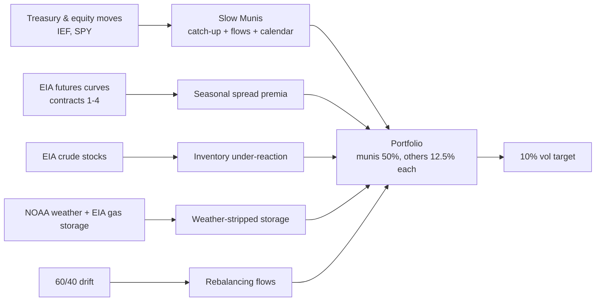
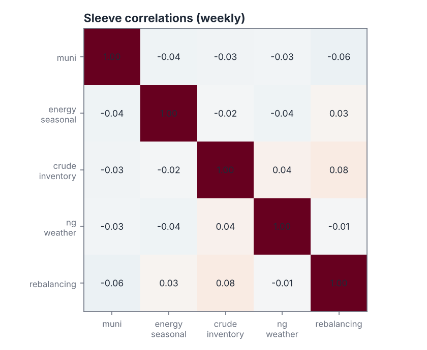

<div align="center">

# Muni Stale-Price Macro

Muni bond ETFs (MUB, VTEB) price in about 70% of a Treasury move the same day and the rest over the next 2-4 days.
This strategy buys them against a Treasury hedge after Treasuries rally and sells after they fall.


**[Project website](https://vibgyor22.github.io/muni-stale-price-macro/)** | [Methodology](docs/methodology.md) | [Literature](docs/literature.md) | [Author](https://vibgyor22.github.io/personal-website/)

</div>

---

## Summary

- **The effect.** When Treasury yields move, muni ETFs move about 70% as far as they eventually will on the same day. The rest arrives over the next 2-4 trading days.
- **The trade.** Buy MUB and VTEB, hedged with IEF, after Treasuries rally; sell them after Treasuries fall. Trades go in at the next morning's open, after costs.
- **The result.** 2018-2026 (held out as the test period): Sharpe ratio 1.9 for the muni strategy alone, 2.25 for the full portfolio, which adds four smaller, uncorrelated commodity and flow strategies. No losing calendar year since 2009.

## Results at a glance


| Portfolio, 10% ex-ante vol target, net of costs | 2008-17 (design) | **2018-26 (out-of-sample)** | Full sample |
|:--|--:|--:|--:|
| Annual return (excess of cash) | 29.9% | **29.2%** | 29.5% |
| Volatility | 10.5% | **11.7%** | 11.1% |
| **Sharpe** | 2.56 | **2.25** | 2.40 |
| Sortino | 4.51 | **3.66** | 4.01 |
| Max drawdown | -6.8% | **-8.6%** | -8.6% |
| Calmar | 4.37 | **3.40** | 3.44 |
| t-stat of Sharpe | 7.7 | **6.7** | 10.1 |
| % positive months | 82% | **75%** | 78% |
| Worst month | -6.8% | **-5.9%** | -6.8% |

<details>
<summary><b>Monthly returns heatmap</b> (click)</summary>


</details>

### Returns by calendar year (10% volatility, after costs)

| Year | Portfolio | Muni only | | Year | Portfolio | Muni only |
|:--|--:|--:|:--|:--|--:|--:|
| 2009 | 17.4% | 13.4% | | 2018 | 21.1% | 9.6% |
| 2010 | 52.1% | 45.6% | | 2019 | 47.9% | 47.6% |
| 2011 | 24.1% | 14.3% | | 2020 | 20.7% | 31.8% |
| 2012 | 20.6% | 19.5% | | 2021 | 21.6% | 16.8% |
| 2013 | 29.9% | 39.2% | | 2022 | 79.4% | 47.0% |
| 2014 | 28.6% | 15.1% | | 2023 | 27.3% | 30.1% |
| 2015 | 35.9% | 27.8% | | 2024 | 6.9% | 4.5% |
| 2016 | 48.2% | 51.2% | | 2025 | 35.9% | 26.1% |
| 2017 | 18.1% | 18.6% | | 2026 (to Oct) | 10.1% | 14.7% |

Returns are excess of cash and before fees. They scale with the volatility target: at 5% volatility, halve them; the Sharpe ratio is unchanged.

## The hypotheses

| # | Hypothesis | Economic mechanism | Data | Verdict (Sharpe, 2018-26 out-of-sample) |
|:--|:--|:--|:--|:--|
| **M** | **Muni ETFs under-react to Treasury and equity moves, then catch up** | Munis barely trade, holders are tax-motivated retail, prices come from vendor models (evaluated pricing). Slow capital also makes fund flows persistent | MUB, VTEB, IEF, SPY (daily open and close) | **1.93** |
| E1 | Energy calendar spreads carry a seasonal risk premium | Storage builds and draws on a calendar (heating, driving, refinery maintenance), so hedging demand for front vs deferred contracts is seasonal | EIA daily NYMEX contracts 1-4 for WTI, NG, heating oil, gasoline (1994-2024) | 0.72 |
| E2 | Markets under-react to sustained crude inventory surprises | Weekly builds are noisy, so the persistent part is under-weighted | EIA weekly crude stocks | 0.19 (faded) |
| G | Gas prices under-react to the non-weather part of storage | 78% of storage changes are weather; the structural remainder is quiet and easy to miss | NOAA station weather (37 airports) + EIA storage | 0.48 |
| R | Month-end 60/40 rebalancing flows are predictable | ~$20tn in fixed-weight mandates must rebalance (Harvey, Mazzoleni & Melone 2025) | SPY, IEF | 0.62 |



## Flagship strategy: Slow Munis

**1. The evidence of slowness.** After a one standard deviation Treasury move, muni ETFs keep moving in the same direction for 2-4 more days:


| | 1-day beta to IEF | 10-day beta to IEF | Share priced the same day | corr(IEF today, hedged muni tomorrow) |
|:--|--:|--:|--:|--:|
| MUB | 0.30 | 0.41 | 73% | 0.11 |
| VTEB | 0.35 | 0.54 | 65% | 0.17 |

**2. The signal.** Position on each muni ETF, hedged with IEF at its rolling 1-year beta (so the bet is the muni-vs-Treasury gap, not the direction of rates):

| Component | Measures | Weight |
|:--|:--|--:|
| Catch-up | EWMA of recent IEF returns, in vol units | 1.0 |
| Risk | Same for SPY (risk sentiment reaches munis late) | 0.3 |
| Calendar | First 5 business days of the month (coupon and redemption reinvestment) | 0.5 |
| Flow | 60-day momentum of the hedged muni return (persistent fund flows) | 0.5 |

**3. Execution.** Signal at the close, trade at the **next open** (so stale closing prints cannot create fake profits), 1bp per side on the muni ETF plus 0.5bp on the hedge, no-trade band to cut turnover.

**4. How the spec was chosen.** 32 variants were ranked on 2008-17 only; the top one is used. Across all 32, the median out-of-sample Sharpe is 1.73 (`results/muni_spec_grid.csv`).

**5. Robustness.**


| Slow munis alone (daily, net) | 2008-17 | 2018-26 |
|:--|--:|--:|
| Base | 1.84 | 1.85 |
| Costs x2 / x3 | 1.65 / 1.47 | 1.62 / 1.38 |
| Catch-up component alone | 1.58 | 1.72 |
| MUB only / VTEB only | 1.77 / 2.06 | 1.58 / 1.92 |
| **Placebo (Treasury moves lagged 1 year)** | **0.07** | **-0.07** |

## Sleeves and diversification

| Sleeve (weekly, net, before final vol target) | 2008-17 | 2018-26 | Full | t-stat |
|:--|--:|--:|--:|--:|
| M. Slow munis | 2.01 | 1.86 | 1.90 | 8.3 |
| E1. Energy seasonal spreads | 0.78 | 0.72 | 0.75 | 3.1 |
| E2. Crude inventory | 0.81 | 0.19 | 0.50 | 2.2 |
| G. NG weather-stripped storage | -0.44 | 0.48 | 0.28 | 0.9 |
| R. Pension rebalancing | 0.92 | 0.62 | 0.79 | 3.5 |
| **Portfolio (munis 50%)** | **2.67** | **2.13** | **2.42** | **10.4** |
| Portfolio (equal weights) | 2.36 | 1.77 | 2.09 | 9.0 |



## Risks and limitations

- **Concentration.** The book's risk is anchored on the muni sleeve; the energy sleeves are diversifiers with lower standalone Sharpe ratios.
- **Weighting.** The muni sleeve carries 50% of risk. An equal-weight book gives 1.77 out of sample.
- **Capacity.** MUB and VTEB trade about $650m a day combined; the sleeve runs about 2-3x gross notional at 10% vol, so realistic capacity is low hundreds of millions.
- **Returns** are excess of cash, before fees, assume leverage at the cash rate and next-open fills at Yahoo's opening print.
- **Data.** EIA stopped publishing its futures-curve series in April 2024, so E1 ends there.

## Reproduce

```bash
git clone https://github.com/vibgyor22/muni-stale-price-macro.git && cd muni-stale-price-macro
pip install -r requirements.txt
python -m src.fetch          # downloads everything (free, no API keys), a few minutes
python run_all.py            # every table and chart in this README, ~10 seconds
python -m src.select_spec    # the train-only specification grid
```

Full numeric output: [`results/report.md`](results/report.md).

## Repository layout

```
src/
  config.py              every parameter, universe, cost and sample split
  fetch.py               data download (Yahoo, EIA, NOAA GHCN)
  data.py                cleaning: futures roll-gap removal, EIA contract stitching
  sleeves/muni.py        M  slow munis (flagship)
  sleeves/energy.py      E1 seasonal spreads, E2 crude inventory
  natgas.py              G  weather-stripped gas storage
  sleeves/rebalancing.py R  pension rebalancing
  portfolio.py           risk-normalised combination
  report.py              tearsheet metrics and charts
  select_spec.py         train-only spec selection
run_all.py               runs everything, writes results/
results/                 charts, KPI tables, report.md
docs/                    literature review and methodology notes
site/                    project website (published from the gh-pages branch)
```

## Literature

Key references (full list in [`docs/literature.md`](docs/literature.md)): Duffie (2010) on slow-moving capital; Choi, Kronlund & Oh (2022, *JFE*) on stale pricing in fixed-income funds; Hong & Stein (1999) on gradual information diffusion; Gorton, Hayashi & Rouwenhorst (2013) on inventories and commodity premia; Harvey, Mazzoleni & Melone (2025) on rebalancing flows.

---

*Research project by [Vibhor Vanvani](https://vibgyor22.github.io/personal-website/). Not investment advice.*
